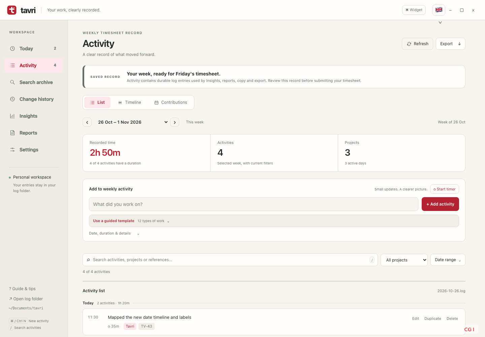
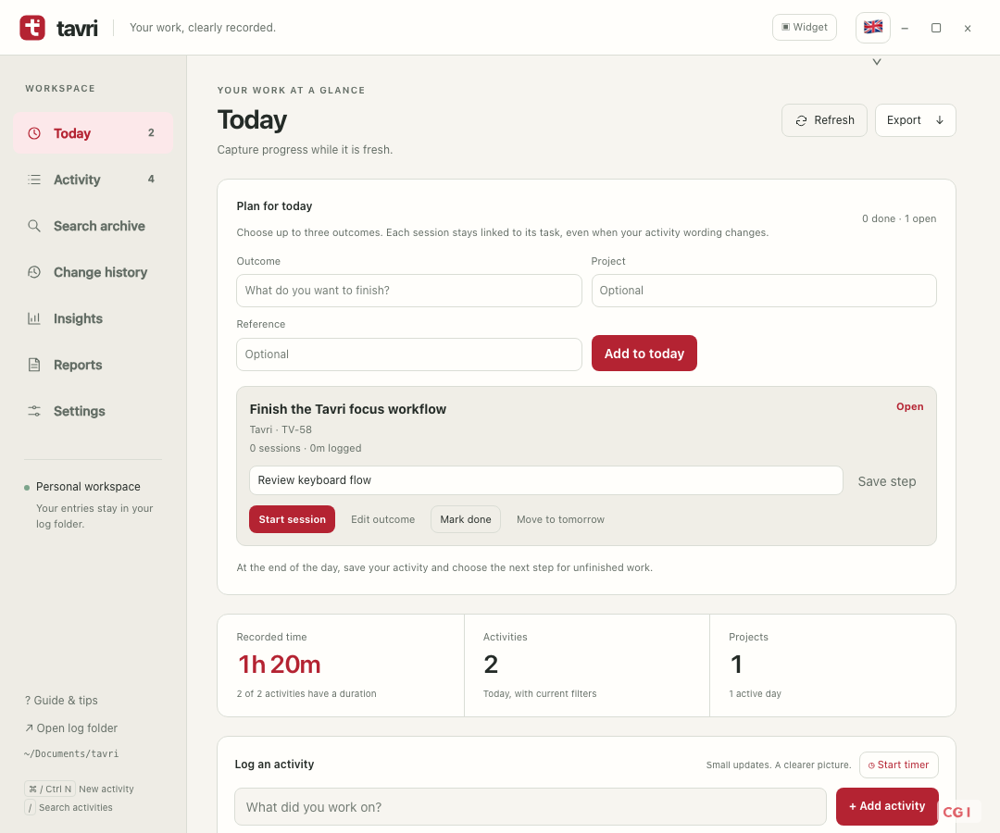
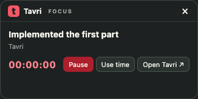
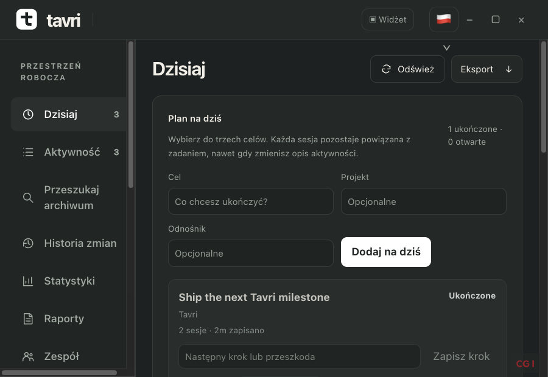
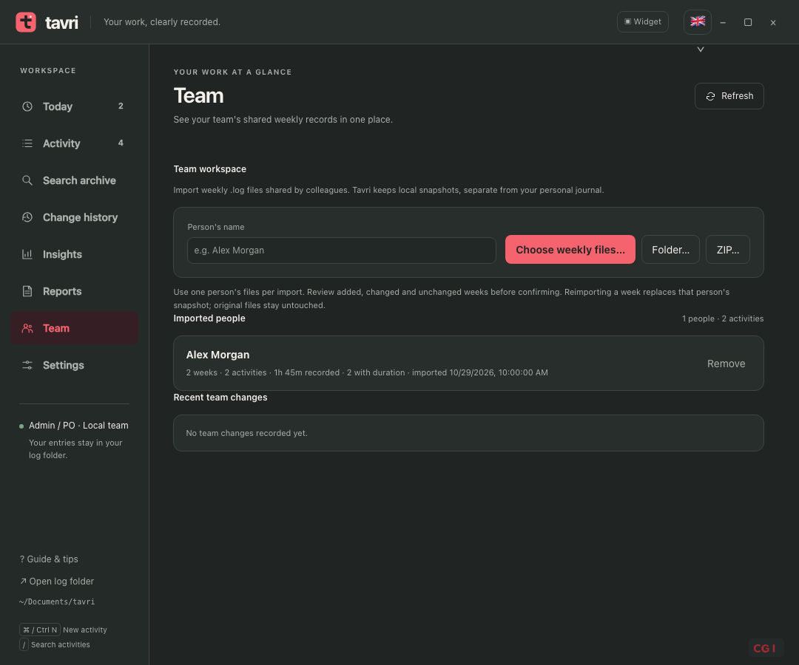
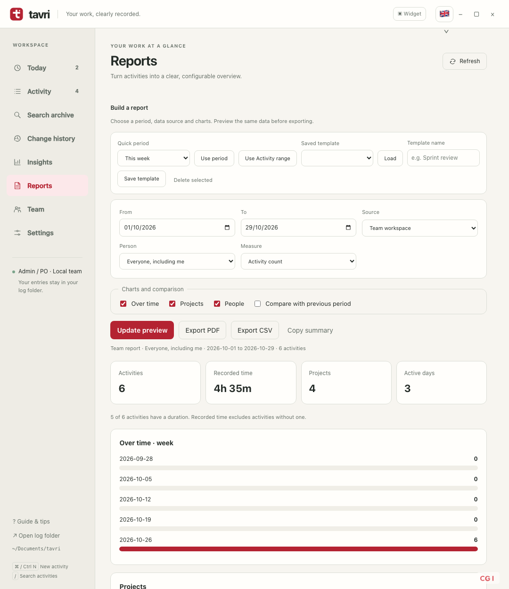

# Tavri

**Your work, clearly recorded.**

Tavri is a local activity journal for your desktop and terminal. Capture what you worked on, add an optional project, reference or duration, and review your week in one place.

Your entries are plain-text files on your computer. The CLI works without Node.js; the desktop application uses Electron.



## Local development

```bash
npm ci
npm run desktop
```

Requirements: Node.js 20 or later and npm for the desktop application. CI uses Node.js 24.

Run the CLI directly from the checkout:

```bash
./tavri.sh add "Improved the weekly export"
./tavri.sh today
./tavri.sh week 2026-W44
```

The local project has been renamed from CGI Worktrace / Tart to Tavri. The Git remote has not been renamed, and a Tavri release has not been published as part of this change. Use the local installation instructions below.

## Install from this checkout

### macOS

```bash
./scripts/install-macos.sh
```

This installs the CLI to `~/.local/bin/tavri`, the desktop launcher to `~/Applications/Tavri.app`, and support files to `~/Library/Application Support/tavri`. This script-based desktop installer needs Node.js and npm; the standalone `.dmg` built below bundles Electron.

Custom locations and CLI-only installation:

```bash
TAVRI_INSTALL_DIR="$HOME/bin" ./scripts/install-macos.sh
TAVRI_MACOS_APP_DIR="$HOME/Desktop" ./scripts/install-macos.sh
TAVRI_SKIP_DESKTOP=1 ./scripts/install-macos.sh
```

### Linux

```bash
./scripts/install.sh
```

This installs the CLI to `~/.local/bin/tavri`. Run `npm ci` and `npm run desktop` from the checkout for the desktop app.

### Windows

Install Git for Windows, then run in PowerShell:

```powershell
powershell -ExecutionPolicy Bypass -File .\scripts\install.ps1
```

The installer places `tavri.cmd` and `tavri.sh` in `%LOCALAPPDATA%\tavri\bin`, and adds that directory to your user PATH. The CLI uses Git Bash. The desktop can be launched from the checkout with `npm ci` and `npm run desktop`.

If `~/.local/bin` is not on your macOS/Linux PATH, add this to your shell profile:

```sh
export PATH="$HOME/.local/bin:$PATH"
```

## CLI

```text
tavri                             Show the current week's log
tavri "message"                   Quickly add an activity
tavri add <message...>             Add an activity for today
tavri list [--week <ref>]          Show a week's entries
tavri today                       Show today's entries
tavri week [<ref>]                Show the week containing a date
tavri path [<ref>]                Print the weekly file path
tavri init                       Create the log directory
tavri config                     Show resolved configuration
tavri version                    Show the version
tavri help                       Show command help
```

Week references accept `YYYY-MM-DD` and `YYYY-Www`. Dates resolve to the Monday of their ISO week. The existing `-t`, `--today`, `-tw`, `--this-week` and `--week` aliases remain available.

```bash
tavri --log-dir "$HOME/my-activity" add "Reviewed a pull request"
tavri list --week 2026-W44
```

## Data and compatibility

The default directory for new users is `~/Documents/tavri`. Each week is stored as `YYYY-MM-DD.log`, where the date is Monday.

```text
2026-10-29 reviewed a pull request
2026-10-29 09:00 refined the layout [spent: 45m] [project: Tavri] [ref: TV-42]
```

Data-directory selection is the same in the main desktop app and CLI:

1. Explicit CLI `--log-dir` or a programmatically supplied store directory.
2. `TAVRI_LOGDIR`.
3. The previous `WORKTRACE_LOGDIR` environment variable.
4. `~/Documents/tavri`, when it contains weekly logs.
5. Existing `~/Documents/worktrace`, when the Tavri directory is absent or empty and the legacy directory contains weekly logs.
6. Otherwise, create `~/Documents/tavri` on the first write.

The rebrand itself does not move or delete existing logs. To consolidate an older `worktrace` folder into canonical Monday-named files, preview and then apply the migration:

```bash
node scripts/migrate-personal-logs.mjs "$HOME/Documents/worktrace" "$HOME/Documents/tavri"
node scripts/migrate-personal-logs.mjs "$HOME/Documents/worktrace" "$HOME/Documents/tavri" --apply
```

The migration groups entries by their actual date, removes copies duplicated across legacy week aliases, and preserves repeated activities within one file. It keeps original files untouched and writes a SHA-256 manifest at `~/Documents/tavri/.tavri-migration.json`. It stops if a destination week already exists. Lines without a recorded time retain no time; no timestamps are invented. After migration, restart Tavri. When both default directories contain weekly logs, Tavri uses `~/Documents/tavri`; set `TAVRI_LOGDIR` to select another location. If the current week has no activities, Activity opens the latest archived week with entries. Use **This week** to return to the current week. `TAVRI_TODAY` and the previous `WORKTRACE_TODAY` override are supported for deterministic tests.

The checkout retains `worktrace.sh`, `worktrace-desktop` and `desktop/worktrace-core.cjs` as compatibility entry points. Installers create the new `tavri` command; an already-installed older command is not replaced automatically.

The desktop reuses an existing `cgi-worktrace` Electron profile when a new `Tavri` profile does not exist, and reads the legacy theme preference. Installer location/skip variables prefixed with `WORKTRACE_` remain fallback aliases on macOS; `WORKTRACE_INSTALL_DIR` also remains supported by the shell installer.

## Desktop

- **Activity / Today:** entries grouped by day, with separate project, duration and reference labels. In Today, plan up to three outcomes, start a linked session, mark results done, record the next step or move unfinished work to tomorrow. Editing an outcome keeps its stable task ID.
- **Activity display tabs:** switch between **List**, **Timeline** and **Contributions**. Tavri remembers the mode. Arrow keys, Home and End navigate the tabs.
- **Timeline:** one horizontal date axis from the first to last visible activity. Every log has a circle, and short activity notes alternate above and below the line when a day has several entries. Click a circle or note for the full entry; activities without a time still appear on their date. Scroll within the timeline if the dates need more room, or choose **Full screen** and press **Esc** to return.
- **Contributions:** a GitHub-style annual calendar, populated from local weekly files, plus a commit-style history for the selected day. Year arrows browse the archive; color levels mean 0, 1, 2–3, 4–6 and 7+ matching entries. Search, project and date filters apply to the entire displayed year; details, clipboard and export follow the selected day when **Current view** is selected. Arrow keys explore days (left/right move a week), Enter selects one.
- **Quick entry:** start with a description; expand date, duration and details when needed. Project suggestions come from the loaded week and today.
- **Activity timer:** start tracking from the quick-entry form. Pause and resume to exclude breaks, then choose **Use time** to fill Duration or save while the timer is active. Saving rounds the elapsed time up to a whole minute and adds it to any duration already entered. Starting sets the entry date and start time; you can edit both before saving. A timer keeps counting across view changes, app reloads and time with Tavri closed until paused or finished. Its status remains visible in the top bar. Discarding the timer keeps the activity draft.
- **Focus widget:** choose **Widget** in the title bar to hide the main window and keep a compact, always-on-top task and timer display. Pause, resume, use the measured time or reopen Tavri from the widget. Its position and size are remembered; the tray menu can reopen it. The widget does not save an activity for you; review and save in the main window.
- **Guided activity templates:** choose from 12 types across delivery, collaboration, product discovery and operations. Each asks three specific questions and previews a concise activity description. Only the first answer is required; the others add useful context. Applying a template fills the description without saving the activity or changing date, time, duration, project or reference. Tavri asks before replacing a description already in progress and restores unfinished template answers on this device.
- **Find your work:** search descriptions, projects and references in the current view or use **Search archive** to search every local weekly file. Archive results include their source week and entry actions. Narrow a search when it has more than 200 results.
- **Stay current:** Tavri checks visible windows every 15 seconds and when you return to the app. Changes made through the CLI or in weekly files appear in the list and annual calendar while your activity and weekly-file drafts stay intact. A stale edit shows a warning before you try to save it.
- **Insights and weekly review:** recorded time, activity count, projects and daily/project breakdowns, plus seven day cards for the selected week. **Time on tasks** groups linked sessions by stable task ID, even when their descriptions change; old unlinked entries still group by description, project and reference. Its bars separate saved durations from the current unsaved timer; their length compares tasks within the selection and does not measure progress toward a target. Durations are optional; tasks without one remain visible without invented time. The weekly review is shown for a selected week; when a multiweek date range is active, list and Insights use that range instead.
- **Edit safely:** Save/Cancel, confirmation before deletion, immediate Undo, and automatic recovery of new-entry and raw-file drafts after reopening. Changing an entry's date can move it to another week through a recoverable two-file transaction.
- **Change history:** a searchable list of desktop activity additions, edits, moves, clones, deletions, undo operations and backup restores, with the actual operation time. Older logs and CLI edits have no creation timestamp in their file format.
- **Export or copy:** apply a From/To range in the Activity filter to see the same multiweek selection in List, Timeline, Insights, clipboard copy and **Current view** export. Alternatively choose **Custom date range** in the Export menu. Dates can span archived weeks and calendar years from 1900 to 9998. Search and project filters apply. TXT, CSV, PDF and clipboard use the same selection. CSV includes `date,time,message,duration_minutes,project,reference`; task IDs remain in the underlying readable log lines.
- **Reports:** a newly selected Activity range carries its dates into Reports; **Use Activity range** reapplies them after editing report dates. You can also use a quick period or custom From/To dates, choose personal or team data, one person, an activity or time metric and chart sections. Save report presets, compare totals with the preceding period of equal length, review a data table, copy a summary, or export PDF/CSV. Empty periods appear in the time chart. Report source, person and chart settings remain independent of Activity filters.
- **Local Admin / PO workspace:** switch modes in Settings, open Team, enter a colleague's name and preview `.log` files, a folder or a ZIP archive before import. Matching weeks update; the preview counts new, changed and unchanged weeks. Remove one imported week or a person, and undo the last workspace change. Original files and your personal journal are unchanged.
- **Settings:** a 38-theme appearance gallery with category and search filters; red, dark-yellow or white accents for the three everyday appearances; Comfortable/Compact timeline density; an advanced editor for the selected weekly file; personal backup/restore and a manual update check.
- **Interface language:** choose English, Polish, German, Spanish, French or Portuguese in Settings or from the flag in the upper right. Tavri remembers the choice, updates the focus widget and formats dates for the chosen language. Existing activity text remains as written. The small CGI mark remains visible at the lower right.
- **Welcome and guide:** a short startup walkthrough shows the main steps and a rotating practical tip. Choose **Don't show this on startup** to skip it later. Open **Guide & tips** from the sidebar for a four-step plan → focus → record → review loop and direct links to Today and Insights.
- **Keyboard:** Cmd/Ctrl+N focuses a new activity, `/` focuses search, Cmd/Ctrl+Enter saves an activity, Escape cancels an activity edit.
- Close or minimize to the tray/menu bar; quit from its menu.

The visualizations use the date/time recorded in each activity, not a separate creation timestamp. They visualize Tavri entries; they do not read Git commits. Use **+ Log activity** in either preview to return to the entry form.







The Admin / PO mode is a local workspace switch, not a login or access-control role. Ask colleagues to share only files they intend you to see; imported content is stored in `<log directory>/.tavri-team/team.json` with a previous manifest in `team.previous.json`. Imports are snapshots, so reimport changed files to update them. Each file must be a Monday-named Tavri weekly log under 5 MB; the workspace is capped at 30 MB. ZIP imports apply extraction and size limits. Reports count activities even when duration is missing, and sum only valid recorded durations. Report exports support PDF and CSV; the activity Export menu supports personal TXT/CSV/PDF/clipboard exports.





List and Timeline search within the selected week; Today searches the current day. Contributions searches the selected calendar year, including its archived weekly files. Search archive and custom export/copy ranges read matching archived weekly files regardless of the selected view.

### Appearance

Choose a preview card or use the selector under **Settings → Appearance**. Browse by category or search by name. For System, Light and Dark, choose **Red** (the default), **Dark yellow** or **White** under **Accent color**. Choices apply immediately and are remembered on this device. White accents use dark outlines and text in Light so controls remain visible. The three high-contrast variants use strong outlines, visible keyboard focus, underlined actions and patterned calendar cells.

The original themed styles include Star Trek · LCARS; Star Wars · Holoterminal, Rebel and Mandalorian; Middle-earth · Shire and Mordor; Hogwarts and Slytherin; Arrakis; Winterfell; Pip-Boy; and Night City. The new **Films** collection includes Blade Runner 2049, TRON: Legacy, The Matrix, Alien and Grand Budapest Hotel. **Books** adds Foundation, Discworld, The Witcher, The Hunger Games and Narnia. **Series** adds Severance, Stranger Things, The X-Files, Doctor Who and The Last of Us. **Music** adds Daft Punk, Pink Floyd, Bowie, Kraftwerk and Radiohead. Each new style has an original line symbol in its preview and the app header. These are original CSS and SVG treatments with no downloaded assets or animations.

Native tests measure representative text/background token pairs (at least 7:1 for the three high-contrast palettes, 4.5:1 for the 35 themed palettes and everyday accent choices), focus visibility and layout at 125% zoom. An automated axe-core WCAG A/AA check covers the main views. This is targeted validation, not a full accessibility certification.

### File safety and recovery

Desktop writes use a temporary file and atomic replacement. Desktop and the bundled CLI coordinate with a `.tavri-write-lock` directory. Edits check the revision read by the UI and reject stale writes; refresh and reconcile your draft when another writer has changed the file. External text editors do not participate in the lock, so avoid editing the same file simultaneously in Tavri and an external editor.

Before replacing a week through edit, duplicate, delete or the advanced editor, Tavri saves the previous version in `<log directory>/.backups/YYYY-MM-DD.log`. This is **one previous version per week**, replaced by the next such operation, not a complete backup history. Undo deletion is available during the current app session and refuses to replace a week changed since that deletion.

Use **Settings → Create backup** to save a checksum-verified JSON backup of all personal weekly files and `.tavri-focus.json`, and **Preview and restore backup** to review its size and affected weeks before restoring. Older version-1 backups without a focus plan remain readable. Tavri first saves the current versions in `<log directory>/.tavri-recovery`. The backup excludes imported team snapshots and unfinished timer/draft state; retain those separately or save the activity before moving to another device. Cross-week moves and focus-plan restoration use `.tavri-transaction.json` so an interrupted operation completes on the next read. Desktop change events are kept in `.tavri-events`.

To recover a backup, quit Tavri and stop CLI writers, copy the current `.log` somewhere safe, then copy the corresponding `.backups` file over it. Keep independent backups of the log folder. If a process crashed and the “log folder is busy” error persists, close all Tavri/CLI processes, verify no writer remains, and remove the empty `.tavri-write-lock` directory before reopening.

The [audit and roadmap](./ROADMAP.md) records the original findings, completed stabilization work and remaining development stages.

## Validation and brand assets

```bash
npm test
npm run test:desktop:integration
npm run test:desktop:screenshot
npm run icons
```

`npm test` includes CLI regression checks, storage/domain tests (including concurrent CLI/desktop writes and simulated write failure), data-directory compatibility tests, asset checks and installer/generator smoke checks. Tests use temporary log directories.

`npm run test:desktop:integration` launches the production Electron main/preload/renderer with temporary logs and an isolated profile. It exercises duplicate editing, deletion/undo, Today/archive context, draft recovery, stale-write rejection, real TXT/CSV/PDF exports, team import/isolation/removal, report charts and PDF, custom cross-week copy/export, 125% zoom, the date timeline, annual calendar, archived row actions, display-mode persistence and keyboard navigation. File-dialog destinations are automated. A graphical session is required; Linux CI uses `xvfb-run`. The test writes sample content to the system clipboard.

The integration test also checks cross-week moves, personal backup/restore, the day plan and stable task links, widget controls, a shared multiweek selection, staged team import and undo, report CSV/comparison/presets, change history and automated accessibility across main views.

The screenshot check renders the production HTML, CSS and renderer with a deterministic fixture and a stub native bridge. It verifies List, Timeline and Contributions across light/dark themes and compact/wide windows, then updates the `src/Screenshot*.png` previews, including all themed appearances, the appearance gallery and the custom export menu. Annual-preview archive data is synthetic and stays in a temporary directory. It does not test native Electron IPC or save dialogs.

Screenshot and icon rendering use headless Google Chrome. Set `TAVRI_CHROME_BIN` if needed; `WORKTRACE_CHROME_BIN` is accepted for compatibility. `npm run icons` rasterizes `assets/tavri-icon.svg` and generates native ICNS/ICO assets using macOS `sips`.

The [brand guide](./docs/BRAND.md) describes the name, mark, palette and asset sources.

## Project starter

```bash
./scripts/create-project-base.sh "Focus Journal" /tmp/focus-journal
```

The generator creates a separate Electron starter with its own app name and data directory. `TAVRI/` contains the previously generated example, now branded Tavri; it is not the main application. The main application lives in `desktop/`.

## Local release packaging

```bash
./scripts/prepare-release.sh v0.4.0 /tmp/tavri-release
npm run package:mac
```

The first command creates source archives, installers and SHA256 checksums locally. The second creates a standalone macOS `.app` and `.dmg` in `dist/` with the Electron runtime, Tavri icon and license, and verifies key files inside the packaged ASAR. It is unsigned by default. For a signed and notarized build, install a Developer ID Application certificate, store notarization credentials in Keychain with `xcrun notarytool store-credentials`, then set `TAVRI_MAC_SIGN_IDENTITY` and `TAVRI_MAC_NOTARY_PROFILE` when running `npm run package:mac`. The script verifies the code signature and stapled ticket before creating the DMG. **Check for updates** in Settings queries GitHub releases only when clicked and opens a verified Tavri release page; it does not install updates automatically. `TAVRI_REPOSITORY` can override the repository used in generated source download URLs; otherwise the source packager uses `GITHUB_REPOSITORY`, falling back to the existing configured project name `dawidpolakowskicgi/CGITART`.

Standalone installers require an explicit `TAVRI_RAW_URL`, `TAVRI_MACOS_ARCHIVE_URL` or PowerShell `-SourceUrl`, unless produced by the release packager. This avoids downloading an older Worktrace build under the new name.

## Project documentation

- [Development roadmap and audit](./ROADMAP.md)
- [Brand guide](./docs/BRAND.md)
- [Interface references and design decisions](./docs/DESIGN-REFERENCES.md)
- [Contributing](./CONTRIBUTING.md)
- [Security policy](./SECURITY.md)
- [Changelog](./CHANGELOG.md)
- [MIT license](./LICENSE)
